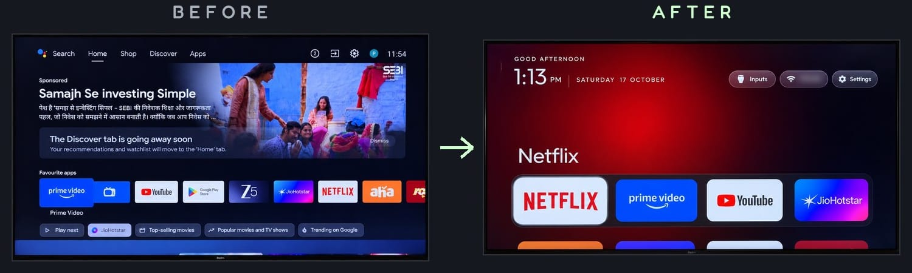
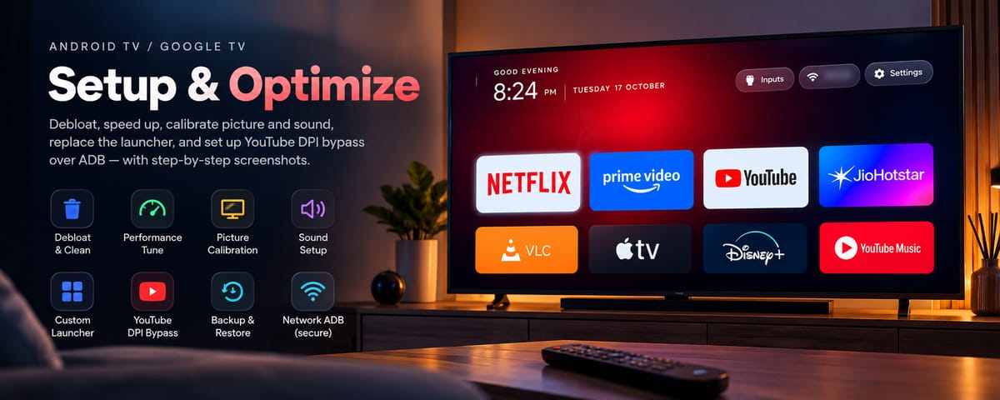

CleanYourTV y CleanTV son dos proyectos de código abierto que usan un agente de IA, como Claude Code, para limpiar y personalizar una tele con Android TV o Google TV: desactivan anuncios y rastreo, cambian la pantalla de inicio y dejan la tele a tu gusto, sin root y con la opción de deshacerlo. Si tu tele es Samsung o LG, de momento no te sirven. Y aunque la idea es muy buena, no está exenta de riesgo: hay gente que ha dejado su tele inservible.

Este artículo se basa en la documentación de los repositorios y en la cobertura de prensa, no en una prueba propia. Por eso te cuento también lo que puede salir mal.

## El nombre lía: hay varios proyectos

Si buscas "cleantv" en GitHub te salen varios repositorios distintos. Estos son los que importan (estrellas a 2 de noviembre de 2026):

| Proyecto | Qué es | Estrellas | Licencia |
|---|---|---|---|
| [CleanYourTV](https://github.com/Gathin23/cleanyourtv) | El viral. Limpieza por Wi-Fi y launcher propio, con cualquier agente de código | 49,2 mil | MIT |
| [CleanTV (JohnWayneeee)](https://github.com/JohnWayneeee/cleantv) | Skill de Claude Code. Te pregunta qué usas y ajusta también imagen y sonido | 31 | MIT |
| [CleanTV (0x006E)](https://github.com/0x006E/cleantv) | Launcher con mando para decodificadores por infrarrojos | 5 | Apache-2.0 |

Me centro en los dos primeros. CleanYourTV es el más probado. CleanTV es el que más se acerca a la idea de "tele a medida", pero tiene muchos menos usuarios.

## Cómo empezó

Según [TechCrunch](https://techcrunch.com/2026/10/19/people-are-using-ai-to-make-their-smart-tvs-dumb-again/), Gathin T. se cansó de los anuncios en la tele de sus padres. Le pidió a Claude Code que lo arreglara, desactivó 25 paquetes de una Xiaomi, creó una pantalla de inicio nueva y publicó el prompt en GitHub. En dos días, miles de personas estaban haciendo lo mismo.

El motivo tiene sentido: muchas teles inteligentes muestran publicidad en la pantalla de inicio y usan el reconocimiento automático de contenido (ACR), que identifica lo que estás viendo.


*Antes y después, del README de CleanYourTV. Imagen: [Gathin](https://github.com/Gathin23/cleanyourtv), licencia MIT, recortada.*

## Qué hace cada uno

**CleanYourTV**, según [su README](https://github.com/Gathin23/cleanyourtv):

- Guarda una copia de los paquetes y ajustes antes de tocar nada.
- Desactiva telemetría, publicidad y apps precargadas con `pm disable-user`, sin desinstalar.
- Instala un launcher de unos 572 KB, sin permisos de red, con dock de cuatro apps, temas, salvapantallas y menú de entradas HDMI.
- Incluye listas probadas para más de 400 modelos de más de 100 marcas.

**CleanTV**, según [el suyo](https://github.com/JohnWayneeee/cleantv), va más hacia la personalización:

- Hace entre 10 y 15 preguntas sobre cómo usas la tele antes de cambiar nada.
- Calibra la imagen según la luz de la sala y desactiva el suavizado de movimiento.
- Configura el sonido: Dolby, diálogos, nivelación de volumen y modo nocturno.
- Mide la memoria antes y después. Su README cita una CHiQ de 2,8 GB que pasa de 1,42 a 1,77 GB libres.
- Incluye un método para esquivar la limitación de YouTube con ByeByeDPI. Si tu conexión no sufre ese problema, yo no lo activaría.


*Banner de CleanTV. Imagen: [JohnWayneeee](https://github.com/JohnWayneeee/cleantv), licencia MIT, redimensionada.*

## Qué teles sirven

| Tele | ¿Funciona? |
|---|---|
| Android TV y Google TV (Xiaomi, TCL, Sony, Philips, Hisense con Android…) | Sí |
| Fire TV | Solo la limpieza en CleanYourTV, sin launcher |
| Samsung (Tizen), LG (webOS), Roku, Hisense VIDAA | No: no tienen ADB |

Mira el sistema de tu tele, no solo la marca: Hisense, por ejemplo, vende modelos con sistemas distintos. Para las no compatibles, CleanYourTV enlaza [una guía](https://cleanyour.tv/not-android) para desactivar el rastreo con el mando.

## Cómo probarlo con cabeza

Necesitas un ordenador en la misma red que la tele, y activar en esta las opciones de desarrollador y la depuración USB. CleanYourTV pide además Python 3, un JDK y el SDK de Android.

Con CleanYourTV, clonas el repositorio, abres la carpeta en tu agente y le pegas el contenido de `PROMPT.md` indicando tu modelo:

```bash
git clone https://github.com/Gathin23/cleanyourtv
```

Con CleanTV, se instala como plugin de Claude Code y luego le dices *"Set up my TV"*:

```text
/plugin marketplace add JohnWayneeee/cleantv
/plugin install android-tv-setup@android-tv-setup
```

Da igual cuál elijas. Estas reglas son las que yo seguiría:

1. **No uses el modo sin permisos** de tu agente. Revisa cada comando que escriba en la tele, como recomienda [esta guía de uso seguro](https://www.developersdigest.tech/blog/cleanyourtv-claude-code-debloat-android-tv-safe-guide-2026).
2. **Comprueba la copia y el script de restauración** antes del primer cambio.
3. **Desactiva por lotes pequeños.** Si algo falla, sabrás qué lo ha causado.
4. **Apaga la depuración al terminar.** El puerto ADB 5555 va en texto plano y, mientras esté abierto, otros dispositivos de tu red podrían intentar conectarse.

## Lo que puede salir mal

- **Dejar la tele inservible.** TechCrunch recoge el caso de una persona con su Android TV inutilizable y otra atascada a medias con su Fire TV. Una lista con paquetes críticos dejó [un Mi TV Stick sin arrancar](https://www.developersdigest.tech/blog/cleanyourtv-claude-code-debloat-android-tv-safe-guide-2026). El último recurso es restablecer de fábrica, y pierdes apps y cuentas.
- **Perder el Wi-Fi o la emisión desde el móvil.** El README avisa de que en Google TV puede ocurrir al desactivar ciertos paquetes.
- **Que se deshaga solo.** Una actualización de firmware puede reinstalar paquetes y devolver el launcher de fábrica.
- **La garantía.** Modificar el software de la tele puede afectarla.
- **Los anuncios de YouTube siguen.** Esto limpia la tele, no lo que sirven las apps por dentro.

Si no quieres meter a un agente en esto, TechCrunch cita launchers alternativos como Projectivy, ATV Launcher y FLauncher, que cambian la pantalla de inicio sin más.

## Por qué me interesa más allá de la tele

Lo llamativo no es la tele, sino el formato. Alguien resolvió un problema con un agente, lo empaquetó en un prompt y unos scripts, y miles de personas lo repitieron en máquinas distintas. Y las buenas prácticas que usa valen para cualquier automatización de una empresa: copia antes de tocar, cambios por lotes, un botón para deshacer y una persona revisando.

Si te interesa este formato, te cuento [cómo crear tu propia skill paso a paso](/blog/crear-skill-claude-paso-a-paso/). Y si en tu empresa hay un proceso repetitivo que quieras empaquetar igual, [escríbeme por WhatsApp](https://wa.me/34611434736?text=Hola%20Javier%2C%20vengo%20de%20tu%20blog%20y%20me%20interesa%20automatizar%20un%20proceso%20de%20mi%20empresa), mira el servicio de [automatizaciones](/servicios/automatizaciones/) o usa el [formulario de contacto](/#contact).

*Foto de portada: tema Aurora de CleanYourTV, de [Gathin](https://github.com/Gathin23/cleanyourtv), licencia MIT.*
