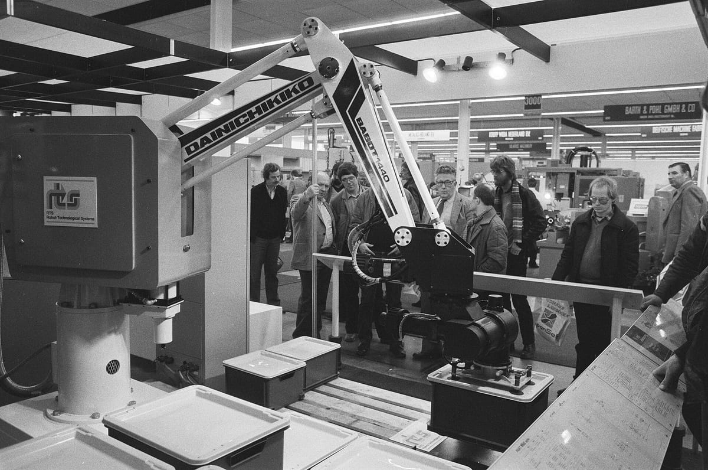

Para la mayoría de las empresas pequeñas, yo empezaría por **Make**: ofrece la mejor relación entre precio y potencia. Elegiría **Zapier** si tienes un par de automatizaciones sencillas y nadie técnico en el equipo, y **n8n** si vas a mover muchas ejecuciones o datos sensibles y alguien puede mantener un servidor. La diferencia real no está en la cuota de entrada, sino en cómo cobra cada una cuando tus flujos crecen.

Precios consultados el 2 de noviembre de 2026, salvo donde indico otra cosa. Cambian a menudo: compruébalos antes de decidir.

## Comparativa rápida

| | Zapier | Make | n8n |
|---|---|---|---|
| Plan gratis | 100 tareas/mes, solo 2 pasos | 1.000 créditos/mes | Community gratis, si la alojas tú |
| Primer plan de pago | 29,99 $/mes o 19,99 $ en pago anual | Desde unos 9 $/mes (*) | 20 €/mes en pago anual |
| Qué incluye | 750 tareas | 10.000 créditos (*) | 2.500 ejecuciones |
| Qué te cobra | Cada acción | Cada operación, en créditos | Cada ejecución del flujo completo |
| Facilidad | La más sencilla | Media, muy visual | La que exige más |
| Puedes alojarla tú | No | No | Sí |

(*) La [página de precios de Make](https://www.make.com/en/pricing) no me mostró el importe al consultarla. El dato es de [una comparativa de julio de 2026](https://yagcomunicacion.com/blog/zapier-vs-make-vs-n8n-empresas-2026/). Los demás son de las páginas oficiales de [Zapier](https://zapier.com/pricing) y [n8n](https://n8n.io/pricing/).

## El detalle que lo cambia todo: qué cuenta cada una

Imagina un flujo de cinco pasos: llega un formulario, lo clasificas con IA, lo guardas en el CRM, avisas por email y actualizas una hoja.

- **En Zapier**, cada acción cuenta como tarea. Ese flujo gasta varias tareas cada vez que se ejecuta.
- **En Make**, cada operación consume créditos, con un coste por paso más bajo.
- **En n8n**, [una ejecución es el flujo entero](https://use-apify.com/docs/academy/comparisons/n8n-vs-make-vs-zapier), tenga dos pasos o veinte.

Con volumen, la diferencia es enorme. [Una estimación de otra comparativa](https://www.smartaiworkspace.tech/blog/n8n-vs-zapier-vs-make-2026) para ese flujo de cinco pasos con 5.000 ejecuciones al mes da unos 299-389 $ en Zapier, 29-49 $ en Make y alrededor de 6 $ en n8n autoalojado. Tómala como orden de magnitud, porque en n8n falta contar el tiempo de quien lo mantiene.

*Automatizar no es nuevo: un robot industrial en una feria en Utrecht, 1982. Foto: [Rob Bogaerts / Anefo](https://commons.wikimedia.org/wiki/File:Technobeurs_82_in_Utrechtse_Jaarbeurs._Een_industriele_robot_op_de_beurs_die_doz,_Bestanddeelnr_932-0570.jpg), [CC0](https://creativecommons.org/publicdomain/zero/1.0/), redimensionada.*

## Zapier: lo más fácil, y lo más caro al crecer

**Elígela si** tienes un par de flujos simples, poco volumen y nadie técnico. Es la que conecta con más aplicaciones y la que antes pone en marcha a alguien sin experiencia.

**Ten en cuenta que** el [plan gratis](https://zapier.com/pricing) solo permite flujos de dos pasos, sin filtros ni webhooks. En cuanto necesitas algo más, pasas a pago, y a más volumen, más sube la factura: el plan Pro con 2.000 tareas ronda los 49 $/mes en pago anual.

## Make: mi opción por defecto

**Elígela si** tus flujos tienen ramas, condiciones o transformaciones de datos, como sincronizar una tienda con tu programa de gestión. Su editor visual enseña muy bien qué está pasando en cada paso.

**Ten en cuenta que** [los créditos caducan](https://www.make.com/en/pricing) al final de cada periodo. Tiene también [un plan para empresas de menos de 20 empleados](https://www.make.com/en/pricing) con descuento: merece la pena preguntar por él. La curva de aprendizaje es algo mayor que en Zapier, pero asumible.

## n8n: control total, si puedes sostenerlo

**Elígela si** vas a tener mucho volumen, flujos complejos con IA o datos que prefieres no pasar por terceros. La [edición Community](https://docs.n8n.io/hosting/community-edition-features/) es gratis y la instalas en tu propio servidor.

**Ten en cuenta que** ["el software es gratis, pero mantenerlo en producción no lo es"](https://yagcomunicacion.com/blog/zapier-vs-make-vs-n8n-empresas-2026/). Hay que sumar el servidor (entre 5 y 80 € al mes según la carga), las actualizaciones, las copias de seguridad y la monitorización. La edición Community tampoco incluye [proyectos ni compartir flujos y credenciales](https://docs.n8n.io/hosting/community-edition-features/) entre el equipo. Si no quieres servidor, su [nube](https://n8n.io/pricing/) empieza en 20 €/mes, y el plan Pro con 10.000 ejecuciones cuesta 50 €/mes, en pago anual.

## Cuál elegir, según tu caso

| Tu situación | Yo elegiría |
|---|---|
| 1-3 flujos sencillos y nadie técnico | Zapier |
| Varios flujos con condiciones y volumen medio | Make |
| Miles de ejecuciones al mes con alguien técnico | n8n |
| Datos sensibles que quieres controlar | n8n autoalojado, con asesoramiento |
| No sabes aún qué automatizar | Make o Zapier en gratis, con un solo flujo |

## Errores que veo venir

- **Elegir n8n "porque es gratis"** sin tener quien lo mantenga. Si se cae y nadie se entera, el ahorro desaparece.
- **Quedarse en Zapier por pereza** cuando la factura ya es alta. A partir de cierto volumen, migrar se paga solo.
- **Comparar solo la cuota.** Cuenta también las horas de montarlo y de arreglarlo cuando una aplicación cambia su API.
- **Olvidar los fallos.** Prueba tu flujo con datos malos: ¿te avisa si falla, o pierdes el pedido en silencio?
- **Olvidar el RGPD.** Si pasan datos de clientes, comprueba dónde se tratan y qué contrato tienes con cada proveedor.

Para migrar de una a otra, lo prudente es [ir flujo a flujo y mantener ambos en paralelo una o dos semanas](https://yagcomunicacion.com/blog/zapier-vs-make-vs-n8n-empresas-2026/) antes de apagar el antiguo.

## Antes de elegir, decide qué automatizar

La herramienta es lo de menos si eliges mal la tarea. Empieza por la que más tiempo te quita y tenga reglas claras. Te dejo ideas en [7 tareas que tu pyme puede automatizar con IA](/blog/tareas-pyme-automatizar-ia/). Y si lo que quieres es dejar de pagar una suscripción, mira primero [si te salen las cuentas](/blog/sustituir-saas-por-herramienta-a-medida/).

Una prueba que recomiendo: monta un solo flujo real, déjalo funcionar dos semanas y mira cuánto consume. Con ese dato eliges con números, no con comparativas como esta.

## ¿Te lo monto?

Si prefieres dedicar tu tiempo a tu empresa, cuéntame qué tarea quieres quitarte de encima y te digo qué herramienta usaría y cuánto costaría. [Escríbeme por WhatsApp](https://wa.me/34611434736?text=Hola%20Javier%2C%20vengo%20de%20tu%20blog%20y%20me%20interesa%20automatizar%20tareas%20de%20mi%20empresa), mira las [automatizaciones](/servicios/automatizaciones/), desde 149 € por automatización con precio de lanzamiento, o usa el [formulario de contacto](/#contact).

*Foto de portada: KUKA Roboter GmbH, Bachmann, [dominio público](https://commons.wikimedia.org/wiki/File:Factory_Automation_Robotics_Palettizing_Bread.jpg), redimensionada.*
