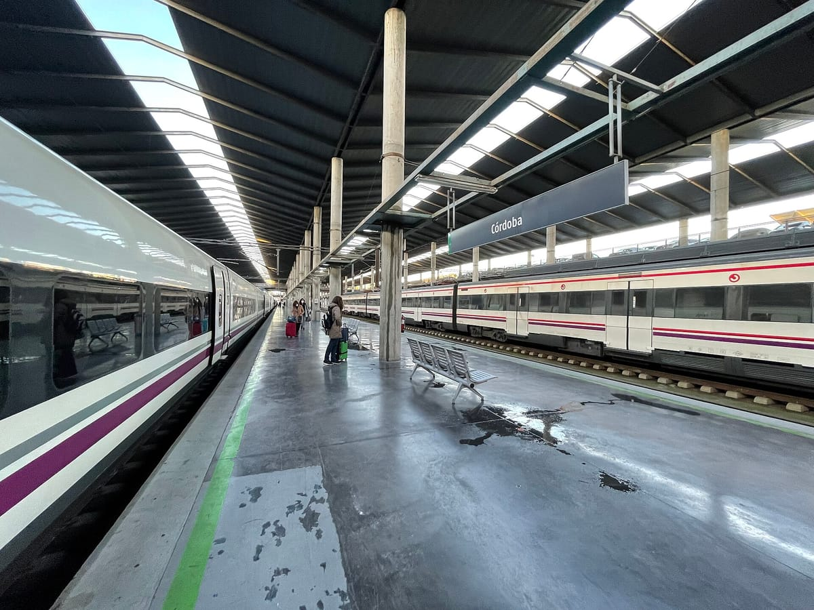

El jueves 29 de octubre de 2026, un día después del accidente ferroviario de Urda (Toledo), el desarrollador Álvaro Hernández enseñó en X [Vía Libre](https://www.elespanol.com/omicrono/20261030/alvaro-creador-app-monitoriza-trenes-renfe-tiempo-real-van-retraso-locos/1003744440979_0.html): un mapa con la posición y los retrasos de los trenes de Renfe, montado en unas tres o cuatro horas con datos públicos. La historia se hizo viral porque enseña dos cosas a la vez: hoy se puede construir muy rápido sobre datos abiertos, y un prototipo hecho en una mañana no es un sistema de seguridad. Lo segundo lo dice él mismo.

## Primero, el contexto

El 28 de octubre, un AVE chocó contra un tren de Iryo [entre Los Yébenes y Urda](https://es.wikipedia.org/wiki/Accidente_ferroviario_de_Urda). El balance provisional es de 69 personas fallecidas y más de 200 heridas. Las causas las están investigando la autoridad técnica y un juzgado, y este artículo no entra en ellas ni saca ninguna conclusión al respecto.

Lo que me interesa aquí es otra cosa, más técnica: qué se puede construir con los datos que ya son públicos y dónde está el límite.

## Qué hacía Vía Libre

Según [El Español](https://www.elespanol.com/omicrono/20261030/alvaro-creador-app-monitoriza-trenes-renfe-tiempo-real-van-retraso-locos/1003744440979_0.html) y [otros medios](https://herqles.com/2026/10/30/joven-web-trenes-retraso-renfe/), era una web gratuita con:

- Un mapa de España con los trenes en circulación: AVE, Avlo, Avant, Alvia, Euromed, Intercity, media distancia y regionales.
- Un semáforo por tren: verde si va en hora, amarillo con retraso moderado, rojo con más de 15 minutos y negro para incidencias.
- Un listado de llegadas con demora y los avisos de la red de Adif.

Hablo en pasado por un motivo: al escribir esto, el 2 de noviembre, la dirección `vialibre.soft-flow.app` redirige a la página de Wikipedia sobre el accidente. No he encontrado ninguna explicación pública de ese cambio, así que no saco conclusiones. Por eso tampoco hay aquí una captura propia.

La frase con la que empezó todo es esta, [de su hilo en X](https://x.com/alvarohdezdp/status/2115886024316362947): *"Esta mañana me dio por pensar cuánto me costaría montar una app para monitorizar los trenes de Renfe. Resulta que la posición GPS de cada tren es pública. 3-4 horas después, estaba funcionando"*.


*Estación de Córdoba. Foto: [MNXANL](https://commons.wikimedia.org/wiki/File:202112_Platform_3,4_of_Cordoba_Station.jpg), [CC BY-SA 4.0](https://creativecommons.org/licenses/by-sa/4.0/), redimensionada.*

## De dónde salen los datos

Esta parte es la que más me gusta, porque es comprobable. Renfe publica datos en su [portal de datos abiertos](https://data.renfe.com/) y, entre ellos, feeds en formato GTFS-RT, el estándar de transporte en tiempo real. El proyecto [Radar España](https://github.com/FlorinTodor/radar-es), que hace algo parecido, documenta cuáles usa:

| Feed | Qué contiene |
|---|---|
| `gtfsrt.renfe.com/vehicle_positions.json` | Posición de Cercanías y Rodalies |
| `gtfsrt.renfe.com/vehicle_positions_LD.json` | Posición de alta velocidad, larga y media distancia |
| `gtfsrt.renfe.com/trip_updates_LD.json` | Retrasos y cancelaciones |

No puedo confirmar que Vía Libre use exactamente estos, pero los he probado y responden sin clave. Consultarlos cabe en tres líneas:

```js
const res = await fetch('https://gtfsrt.renfe.com/vehicle_positions_LD.json');
const { entity = [] } = await res.json();
console.log(`${entity.length} trenes con posición ahora mismo`);
```

Si lo ejecutas de madrugada, como hice yo, verás cero trenes. Es normal: casi no hay circulación.

Eso no significa que todo sea tan sencillo. Radar España explica que no integra Adif porque su web rechaza a los clientes automatizados y no publica esos datos en el punto de acceso nacional, y ha preparado una solicitud formal. Cada fuente, además, tiene sus condiciones de uso: las de Renfe están en [su aviso legal](https://data.renfe.com/legal).

Tampoco era la primera herramienta de este tipo. Existen [RadarDeTrenes](https://radardetrenes.com/en) y el propio [visor en tiempo real de Renfe](https://wwwhatsnew.com/2026/03/10/renfe-estrena-un-radar-para-saber-donde-esta-tu-tren-en-tiempo-real/). Lo que llamó la atención fue el tiempo que tardó una sola persona.

## La cifra viral, bien leída

El dato que corrió por redes fue que, a las 20:27 de ese jueves, [93 de los 119 trenes del sistema iban con retraso](https://actualidadvalencia.com/web-trenes-renfe-tiempo-real-retrasos/), un 78,2 %. Hay que leerlo con cuidado:

- Es una **foto de un momento**, no la puntualidad de la red.
- Ese mismo día había una **huelga de maquinistas** convocada por Semaf, con alteraciones y cancelaciones, y un día antes había ocurrido el accidente.
- La cifra la da el propio creador y, como recoge [Herqles](https://herqles.com/2026/10/30/joven-web-trenes-retraso-renfe/), no está verificada de forma independiente.

Esto no quita valor al proyecto. Pero enseña algo útil: un número en un mapa parece un hecho, y sin contexto puede contar otra historia.

## Lo que Vía Libre no es

Hernández lo deja claro: *"No pretendo que se controlen los trenes de España"* con una aplicación hecha en una mañana. Y añade que su proyecto *"es una crítica a la falta de voluntad (política) para innovar y crear y usar lo que ya hay para mejorar la seguridad"*. Esa crítica es suya, y juzgarla requiere conocer la señalización ferroviaria mucho mejor que yo.

Lo que sí sé, como desarrollador, es que pintar un punto en un mapa y garantizar la seguridad de una red son problemas de categorías muy distintas. Lo primero se resuelve en una mañana. Lo segundo exige sistemas certificados, redundancia y años de pruebas.

## Qué puede aprender una empresa pequeña

Sin comparar lo incomparable, hay tres ideas que sirven a cualquiera:

**1. Quizá ya tienes los datos.** Muchas empresas tienen información repartida en su programa de gestión, en hojas de cálculo o en la agenda, y nadie la mira junta. Un panel sencillo puede responder a una pregunta concreta en días, no en meses.

**2. Un prototipo responde a una pregunta. Un producto, a todo lo demás.** Esta es la diferencia que más se olvida:

| | Prototipo de una mañana | Herramienta para usar a diario |
|---|---|---|
| Objetivo | Comprobar si la idea funciona | Que funcione siempre |
| Si falla la fuente de datos | Se ve vacío | Avisa y guarda lo último válido |
| Usuarios y permisos | No hacen falta | Imprescindibles si hay datos internos |
| Mantenimiento | Ninguno | Continuo |

Lo cuento con más detalle en [mi guía para integrar una API en tu web](/blog/integrar-api-en-tu-web-guia/) y en [cómo gestioné la caché y los límites en API Vuelos](/blog/api-vuelos-cache-rate-limit/), un proyecto propio con datos en tiempo real.

**3. Define qué mides antes de enseñarlo.** "93 de 119" impacta, pero la pregunta es: ¿respecto a qué, cuándo y con qué datos? Lo mismo vale para el panel de ventas de tu empresa.

Si en tu empresa hay datos repartidos que te gustaría ver en un solo sitio, puedes contármelo por el [formulario de contacto](/#contact).

*Foto de portada: [Dietmar Rabich](https://commons.wikimedia.org/wiki/File:D%C3%BClmen,_B%C3%B6rnste,_Eisenbahnlinie_Dortmund-Enschede_--_2015_--_9918_%28cinematic%29.jpg), [CC BY-SA 4.0](https://creativecommons.org/licenses/by-sa/4.0/), redimensionada.*
