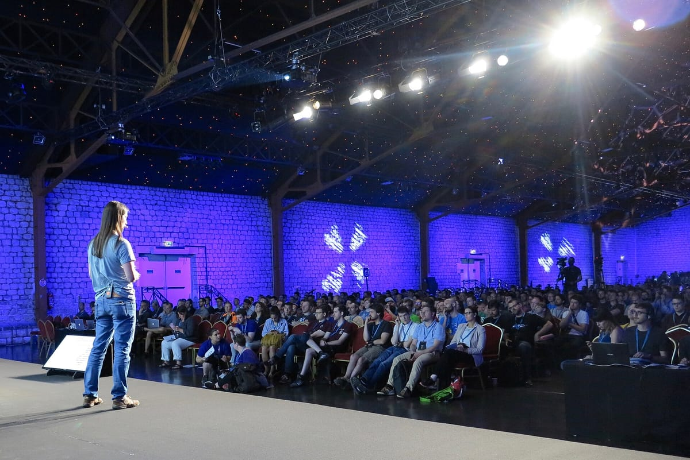

Si la web de tu empresa está hecha con WordPress, comprueba hoy mismo que está actualizada. En julio de 2026, [INCIBE avisó de dos vulnerabilidades](https://www.incibe.es/incibe-cert/alerta-temprana/avisos/multiples-vulnerabilidades-en-wordpress), una de ellas crítica, con intentos de explotación activa, y las empresas pequeñas son el objetivo más frecuente: el 60 % de los incidentes gestionados en 2025 afectó a pymes y autónomos. Se revisa en diez minutos. Te cuento qué mirar, cuándo pedir ayuda y a quién llamar si ya te han atacado.

Aviso de parte interesada: yo no suelo hacer webs con WordPress, sino con Astro y Next.js, así que tengo mi sesgo. WordPress no es malo: una buena instalación bien mantenida es perfectamente válida. El problema suele ser una web que nadie cuida desde que se publicó.

## Los datos

Según el balance de INCIBE recogido por [Revista Ciberseguridad](https://www.revistaciberseguridad.com/2026/06/incibe-registra-122-000-incidentes-de-ciberseguridad-en-2025-el-60-afecto-a-pymes/), en 2025 se gestionaron 122.138 incidentes, un 18 % más que en 2024:

| Tipo de incidente | Casos aproximados |
|---|---|
| *Phishing* y fraude digital | 47.000 |
| Malware | 23.400 |
| Accesos no autorizados | 18.200 |
| *Ransomware* | 9.800 |

Sobre WordPress, el [aviso de INCIBE-CERT](https://www.incibe.es/incibe-cert/alerta-temprana/avisos/multiples-vulnerabilidades-en-wordpress) del 20 de julio, actualizado el 22, detalla:

| Vulnerabilidad | Severidad | Afecta a | Corregida en |
|---|---|---|---|
| CVE-2026-63030 | Crítica | WordPress 6.9 | 6.9.5 |
| CVE-2026-60137 | Alta | WordPress 6.8 y 6.9 | 6.8.6 y 6.9.5 |

También hay un [aviso posterior en agosto](https://www.moncloa.com/2026/08/13/incibe-cert-vulnerabilidad-wordpress-ejecucion-codigo-3414938) sobre otra vulnerabilidad de subida de archivos. Así que el criterio no es "tengo la 6.9.5", sino "tengo la última versión disponible de mi rama".

*Ponencia en una WordCamp. Foto: [olivier gobet](https://commons.wikimedia.org/wiki/File:Demystifying_the_WordPress_Bootstrap_Process_-_Alain_Schlesser_%2835272097491%29.jpg), [CC BY 2.0](https://creativecommons.org/licenses/by/2.0/), redimensionada.*

## ¿Por qué iban a atacar mi empresa?

Porque la mayoría de los ataques a webs no son personales. Son programas que recorren internet buscando versiones con fallos conocidos. Tu web no tiene que ser interesante, solo vulnerable. Y lo que buscan suele ser:

- Usarla para colgar páginas de fraude o enlaces de spam.
- Infectar a quien la visita.
- Robar los datos que hayan dejado tus clientes en formularios o tiendas.

El resultado para ti: Google puede marcar tu web como peligrosa, tus correos pueden acabar en spam y tus clientes se llevan un susto. Además, si había datos personales, tienes obligaciones legales.

## Qué revisar hoy, en diez minutos

1. **Versión de WordPress.** Entra en Escritorio → Actualizaciones. Si hay algo pendiente, pídeselo a quien te lleve la web. Antes, una copia de seguridad.
2. **Plugins y temas.** Son el punto débil más habitual. Actualiza los que uses y **elimina** los que no: desactivarlos no siempre basta.
3. **Usuarios.** Borra las cuentas de antiguos empleados o proveedores, y comprueba quién es administrador.
4. **Doble factor.** Actívalo en todas las cuentas de administrador. Según el [mismo balance](https://www.revistaciberseguridad.com/2026/06/incibe-registra-122-000-incidentes-de-ciberseguridad-en-2025-el-60-afecto-a-pymes/), es una de las medidas básicas recomendadas.
5. **Copias de seguridad.** Pregunta dos cosas: ¿con qué frecuencia se hacen y **fuera del servidor**? Y la que casi nadie pregunta: ¿cuándo se probó a restaurar una por última vez?
6. **Quién se encarga.** Si la respuesta es "el chico que me la hizo hace cuatro años", ya has encontrado el problema más urgente.

Si después de esto no sabes dónde mirar, busca tu dominio en la [herramienta de Navegación Segura de Google](https://transparencyreport.google.com/safe-browsing/search?hl=es), que indica si lo considera peligroso.

## ¿Mantener, actualizar o cambiar de web?

| Tu situación | Qué haría |
|---|---|
| Web actualizada con alguien responsable | Mantenerla como está |
| Desactualizada pero en buen estado | Actualizar, hacer limpieza y contratar mantenimiento |
| Muchos plugins, lenta y sin responsable | Valorar rehacerla |
| Solo informativa, casi no la cambias | Una web estática puede encajar mejor: no hay panel público ni base de datos que atacar |
| Tienda online o zona de clientes | No reduzcas el mantenimiento, súbelo |

Una web estática, como la que hago con Astro, reduce mucho lo que se puede atacar, pero no es invulnerable: sigue dependiendo de librerías, formularios y cuentas de terceros que hay que cuidar.

## Si crees que ya te han atacado

- **Llama al 017.** Es la [línea de ayuda de INCIBE](https://www.incibe.es/linea-de-ayuda-en-ciberseguridad): gratuita y confidencial, atiende a empresas, todos los días de 8:00 a 23:00.
- **No borres nada todavía.** Haz una copia del estado actual: puede servir para saber qué pasó.
- **Cambia las contraseñas** de administrador, alojamiento y correo, desde un equipo limpio.
- **Si hay datos personales afectados,** puede que tengas que notificarlo a la [AEPD](https://www.aepd.es/) en un máximo de 72 horas. Consúltalo enseguida con quien te asesore.
- **Avisa a tu proveedor de alojamiento,** que muchas veces detecta y aísla el problema.

## ¿Quieres que le eche un vistazo?

Para una primera revisión, pásala por mi [analizador web gratuito](/analizador-web/), que detecta si usa WordPress y comprueba lo básico. Si prefieres que la mire yo, pásame la dirección y te digo qué me preocuparía. [Escríbeme por WhatsApp](https://wa.me/34611434736?text=Hola%20Javier%2C%20vengo%20de%20tu%20blog%20y%20quiero%20revisar%20la%20seguridad%20de%20la%20web%20de%20mi%20empresa) o usa el [formulario de contacto](/#contact). Si toca rehacerla, la [web profesional](/servicios/diseno-web-cordoba/) empieza en 349 € con precio de lanzamiento, con mantenimiento opcional de 19 €/mes.

*Foto de portada: [Victorgrigas](https://commons.wikimedia.org/wiki/File:Wikimedia_Foundation_Servers-8055_15.jpg), [CC BY-SA 3.0](https://creativecommons.org/licenses/by-sa/3.0/), redimensionada.*
